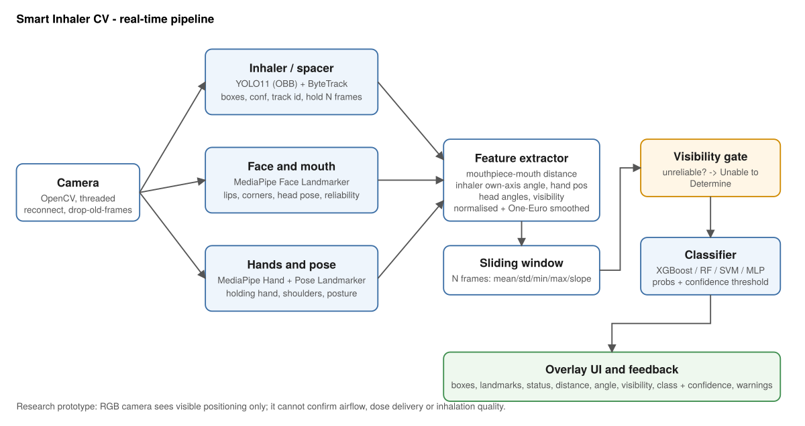

# Smart Inhaler CV - live camera inhaler-technique detection

Part of the thesis *IoT Smart Inhaler for Health Monitoring and Early Lung Cancer Detection Using
Machine Learning and IoT*. A real-time computer-vision system that watches a person demonstrate
inhaler use and classifies the visible technique into **Correct**, **Wrong Mouth Position**,
**Wrong Inhaler Position** or **Unable to Determine**, after analysing a window of consecutive frames.

> **Limitation.** A normal RGB camera assesses *visible positioning only*. It cannot confirm
> airflow, medication delivery or inhalation quality. This is a research prototype, not a
> clinically validated medical device.



## What is in this repo

| Path | Purpose |
|---|---|
| `src/camera.py` | Threaded OpenCV capture, reconnect, drop-old-frame policy; video-file mode |
| `src/detector.py` | YOLO11 inhaler/spacer detection (detect or OBB), ByteTrack, hold-through-dropout, angle from the object's own axis |
| `src/face_mouth.py` | MediaPipe Face Landmarker: lips, corners, mouth centre/region, head pose, reliability |
| `src/hands_pose.py` | MediaPipe Hand + Pose Landmarker: holding-hand selection, shoulders, posture |
| `src/features.py` | Normalised geometric features, One-Euro smoothing, sliding windows, visibility gate |
| `src/classifier.py` | Gate -> trained model (RF / SVM / XGBoost / MLP) -> confidence threshold -> label stabiliser; rule-based bring-up fallback |
| `src/overlay.py`, `src/app.py` | Live overlay UI, recording mode, session summary |
| `training/` | `train_yolo.py`, `augment_dataset.py` (hand-occlusion/blur/lighting), `extract_features.py`, `train_classifier.py` (LOSO) |
| `evaluation/` | `audit_detector.py` (inspect existing best.pt), `fps_latency.py`, `metrics.py` (coverage, accuracy, confusion matrix) |
| `docs/` | Architecture, technique checklist template, dataset protocol |
| `tests/` | Unit and integration tests (stubbed models; run without camera or weights) |

## Install

```bash
python -m venv .venv && source .venv/bin/activate     # Windows: .venv\Scripts\activate
pip install -r requirements.txt
python scripts/download_models.py                      # MediaPipe .task bundles -> models/mediapipe/
```

Put your trained detector at **`models/best.pt`** (a YOLO11 model with classes `inhaler` and
`spacer`). If you do not have one yet, train it (step 2 below). Python 3.10-3.12 recommended.
GPU is optional; set `detector.device` in `configs/config.yaml`.

## Workflow (follows the project's priority order)

**1. Audit the existing model first** - do not rebuild what already works:
```bash
python evaluation/audit_detector.py --weights models/best.pt --source test_clip.mp4 --data data/inhaler.yaml
```
Reports mAP, per-class coverage, longest missed streak (hand occlusion shows up here) and track-ID switches.

**2. Make inhaler detection reliable** (only if the audit shows gaps):
```bash
python training/augment_dataset.py --images data/roboflow/train/images --labels data/roboflow/train/labels \
       --out data/roboflow_aug/train --copies 2 --keep-originals     # synthetic hand occlusion, blur, lighting
python training/train_yolo.py --data data/inhaler.yaml --model yolo11s.pt --epochs 100      # -> models/best.pt
python training/train_yolo.py --data data/inhaler_obb.yaml --model yolo11s-obb.pt           # oriented boxes (recommended)
```
Add your own webcam frames (hands covering the inhaler, dim and bright rooms). Use an **OBB model**
if you want the angle measured from the object itself: a plain detect model only yields a
horizontal/vertical axis (flagged `box` on screen, `obb` when reliable).

**3. Run the live demo:**
```bash
python -m src.app                       # webcam 0
python -m src.app --camera-only         # webcam 0 without models/best.pt
python -m src.app --source rtsp://...   # phone stream (IP-camera apps)
python -m src.app --source clip.mp4
```
Keys: `q` quit, `r` toggle recording, `s` screenshot. Without a trained classifier the app uses
**placeholder rule thresholds** and says so on screen; replace them (step 5).

**4. Build the technique dataset** (>= 10 subjects, see `docs/DATASET_PROTOCOL.md`):
```bash
# live, per-frame features written straight to CSV, labelled by the command line
python -m src.app --record --person-id P01 --label wrong_mouth --error-type mouth_too_far \
       --angle front --lighting dim --distance far
# or from pre-recorded videos listed in data/annotations.csv (template: data/annotations_template.csv)
python training/extract_features.py --annotations data/annotations.csv --out data/features
```

**5. Train and evaluate the classifier (subject-independent):**
```bash
python training/train_classifier.py --data data/features data/recordings --model all
python training/train_classifier.py --model xgb --features all --tune               # larger feature set + nested group-CV tuning
python training/train_classifier.py --model xgb --exclude-prefix hand_ --report-dir evaluation/results/no_hand   # ablation
python evaluation/metrics.py --predictions evaluation/results/loso_predictions_xgb.csv
```
Evaluation is **Leave-One-Subject-Out** on `person_id` (no person in both train and test).
Outputs: per-model LOSO accuracy / macro-F1, majority-class baseline, uncertain-prediction rate,
confusion matrices (`evaluation/results/confusion_*.png`), per-subject accuracy,
`models/technique_clf.joblib`.

**6. Measure real-time performance on your hardware:**
```bash
python evaluation/fps_latency.py --source 0 --frames 300
```
Reports FPS, per-stage and per-frame inference time, end-to-end latency (capture -> annotated frame)
and uncertain-prediction rate, with hardware info. Quote measured values only.

## How classification works

1. Per frame: YOLO box/axis + face/mouth + hand/pose landmarks -> geometric features, all normalised
   by image size or by *face width* (outer-eye distance), then One-Euro smoothed.
2. Per window (default 20 frames): mean/std/min/max/slope of each feature.
3. **Visibility gate:** if the inhaler, face or mouth was not reliably visible in enough of the
   window, the output is *Unable to Determine* without consulting the model.
4. Model probabilities below `classifier.uncertain_threshold` also give *Unable to Determine*.
5. A hysteresis stabiliser stops the displayed label flickering.

The inhaler angle always comes from the inhaler's own geometry (oriented-box long axis), never from
hand or wrist lines. Coverage/visibility values are deliberately **not** classifier inputs, so the
model cannot learn recording conditions as a shortcut.

## Before you rely on any number

* **Criteria must come from a clinician.** "Wrong mouth position" and "wrong inhaler position"
  need numeric definitions for your specific device (`docs/TECHNIQUE_CHECKLIST.md`). The
  rule-based fallback thresholds in `configs/config.yaml` are placeholders.
* With ~10 subjects, expect wide confidence intervals; report per-subject results, not just the mean.
* Head-pose angles are signed proxies from a generic face model (consistent, not metric).
* `Face Landmarker` reliability is a heuristic (inside frame x face size x temporal stability).

## Tests

```bash
pytest -q          # 13 tests; no camera, weights or MediaPipe model files required
```
