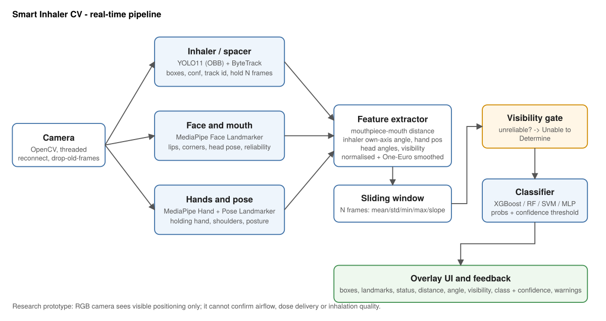
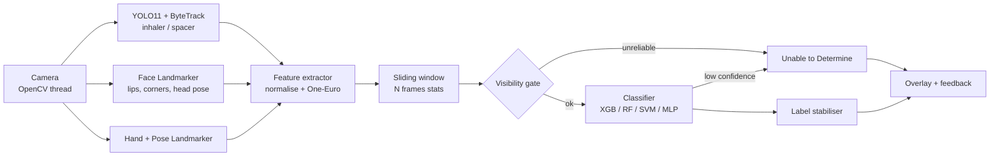

# Technical documentation

## 1. Data flow

`InhalerPipeline.process(frame)` (src/pipeline.py) runs the stages sequentially and records the
time of every stage in milliseconds, which `evaluation/fps_latency.py` aggregates.

## 2. Modules

| Module | Responsibility | Key decisions |
|---|---|---|
| `camera.py` | Live capture thread keeping only the newest frame; reconnect after 3 failed reads (up to `reconnect_attempts`); synchronous file mode | Dropping old frames bounds latency instead of letting a queue grow |
| `detector.py` | `model.track()` (ByteTrack); parses detect or OBB results; keeps the last detection for `hold_frames` with decaying confidence | Hold bridges short hand-occlusion dropouts; `held` is flagged and drawn grey |
| `face_mouth.py` | 478 landmarks; mouth centre from lip corners + inner lips; open ratio; face scale; roll from the eye line; yaw/pitch from `solvePnP` on 6 points | Reliability = in-frame fraction x face-size score x temporal stability |
| `hands_pose.py` | Hand whose landmarks are nearest the inhaler box (within `hold_dist_frac` x box diagonal); pose every N frames cached in between | Pose is slow-changing, so caching saves time |
| `features.py` | Per-frame features, smoothing, windows, gate | Distances in face-width units; angles are undirected axes (wrap-safe) |
| `classifier.py` | Gate, model, threshold, rule fallback, stabiliser | "Unable to Determine" is a decision, never a trained class |
| `overlay.py` / `app.py` | UI, recording, session summary | Warning banner whenever visibility is insufficient |

## 3. Features (per frame)

| Feature | Definition |
|---|---|
| `inhaler_cx/cy`, `mouth_cx/cy`, `mouthpiece_x/y` | Positions divided by image width/height |
| `mp_rel_x/y`, `mp_mouth_dist` | Mouthpiece end (axis end nearest the mouth) minus mouth centre, in face-widths; `mp_mouth_dist` is the norm |
| `inhaler_angle` | Angle of the inhaler's own long axis (OBB), in [-90, 90) |
| `inhaler_angle_rel_head` | `inhaler_angle` minus head roll |
| `inhaler_size` | Long-axis length in face-widths |
| `hand_inhaler_dist`, `hand_mouth_dist`, `hand_rel_x/y` | Palm centre of the holding hand relative to inhaler centre / mouth, face-widths |
| `head_yaw/pitch/roll` | Head orientation (signed proxies) |
| `mouth_open_ratio` | Inner-lip gap / mouth width |
| `torso_lean`, `shoulder_tilt` | Posture from pose landmarks |
| `inhaler_conf`, `face_vis`, `mouth_vis`, `hand_vis`, `pose_vis` | Landmark/detection reliability (gate and HUD only) |
| `has_inhaler/face/mouth/hand` | Validity flags used for coverage and gating |

Features that depend on an unreliable landmark group are set to NaN rather than computed from
bad data. Window statistics ignore NaNs; the classifier pipeline imputes remaining gaps with the
training median.

## 4. Classification

* Windows of `features.window_size` frames (20 by default, ~0.7 s at 30 FPS); training windows slide
  by `window_stride_train`.
* Default inputs (`--features core`): mean/std/min/max of 12 geometric features. `--features all`
  adds slopes and every position feature.
* Models: Random Forest, SVM, XGBoost, MLP, all behind a median imputer; class-balanced.
* Validation: `LeaveOneGroupOut` on `person_id`; hyper-parameters fixed, or tuned with a nested
  `GroupKFold` search inside each training set (`--tune`, final fit only).
* Output: class probabilities; confidence below `uncertain_threshold` -> *Unable to Determine*.
* Multi-label extension: store one binary column per error type in the annotations and replace the
  final estimator with `OneVsRestClassifier`; the gate, features and UI are unchanged.

## 5. Evaluation protocol

| Metric | Where | How measured |
|---|---|---|
| FPS, ms/frame, per-stage ms, end-to-end latency | `evaluation/fps_latency.py` | timestamps at capture and after overlay drawing, warm-up excluded |
| Inhaler coverage, face %, mouth landmark %, hand % | `evaluation/metrics.py` | validity flags over recorded frames, split by angle / lighting / distance |
| Accuracy, macro-F1, confusion matrix, per-subject accuracy | `train_classifier.py`, `metrics.py` | LOSO predictions |
| Uncertain-prediction frequency | both | share of windows labelled *Unable to Determine* |
| Detector mAP, miss streaks, ID switches | `evaluation/audit_detector.py` | validation set + probe video |

## 6. Failure modes and mitigations

| Failure | Mitigation |
|---|---|
| Hand hides the inhaler | Occlusion/blur augmentation, tracker + hold, window-level coverage rather than per-frame decisions |
| Head turned / face partly out of frame | Reliability score, features NaN-masked, gate -> *Unable to Determine* |
| Dark scene | Gamma lift before MediaPipe (`pipeline.enhance_dark`) |
| Camera drop | Reconnect loop; UI shows "signal lost" instead of stale results |
| Small dataset | Small regularised models, LOSO, report variance, baseline comparison |
| Ambiguous "wrong mouth" vs "wrong inhaler" | Clinician-defined numeric criteria; consider multi-label |

## 7. Performance tuning

`detector.imgsz`, a smaller YOLO (`yolo11n`), `pose.every_n_frames`, `pose.enabled: false`,
`hands.max_hands: 1`, a lower camera resolution, or `detector.half: true` on GPU. Stages run
sequentially; running YOLO and MediaPipe on separate threads is the next step if more FPS is needed.
